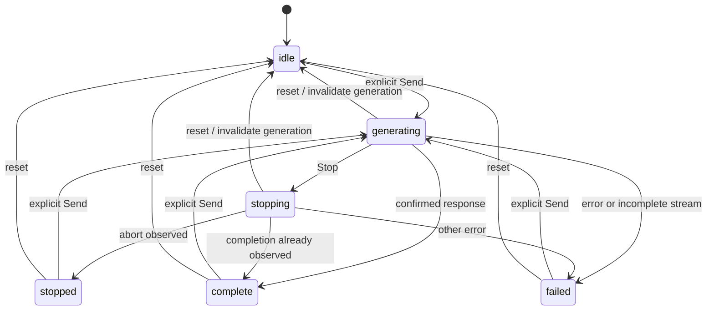
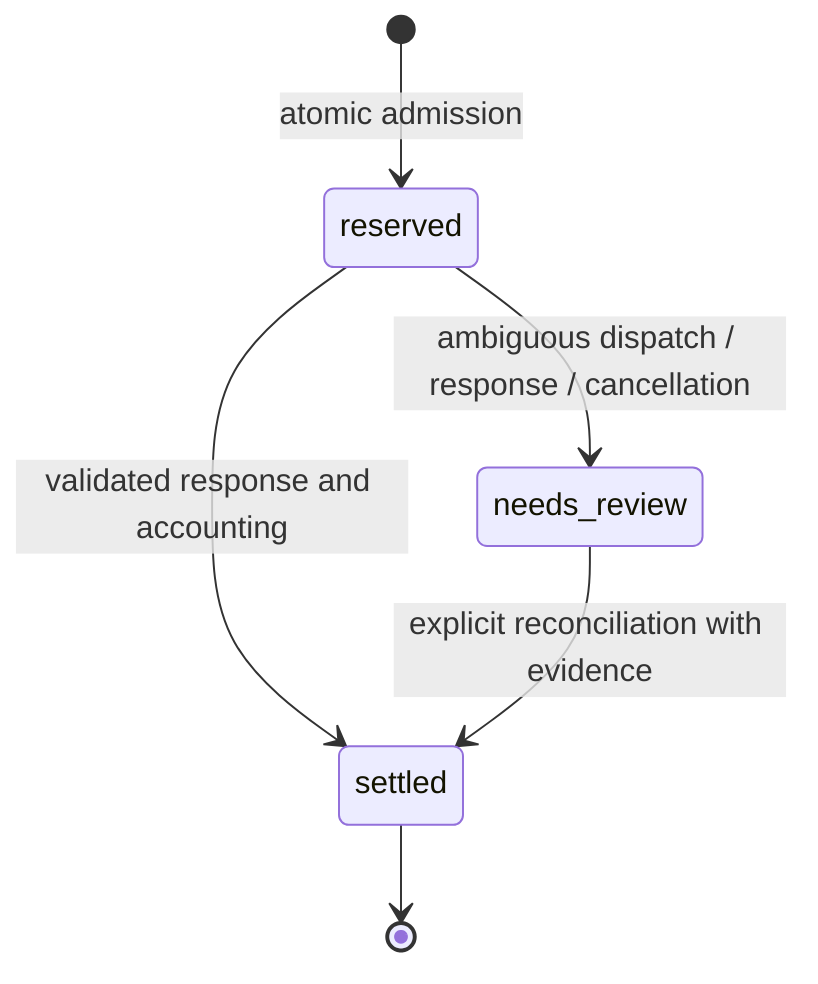

# State machines and transition ownership

This inventory covers the application, browser clients, local operator tools and
release tooling. It includes implicit machines encoded in booleans, counters,
timestamps, SQL predicates and async callbacks. Names below describe existing
behavior; they are not new API or database enum values. Pure calculations,
schemas and formatting helpers have no independent lifecycle.

## Design decision

Keep durable transitions inside their existing SQLite transactions. Make browser
operation ownership explicit where it prevents stale output or duplicate writes.
Do not introduce a state-machine dependency or migrate persisted states merely
to make the diagrams uniform. Authentication, accounting, display freshness and
treasury evidence have different authorities and must remain separate.

Every change should improve all three experiences together:

- **UX:** controls reflect the current operation; cancellation, unknown data and
  billing uncertainty have truthful messages and a clear recovery action.
- **DX:** one owner writes each lifecycle; derived flags are not independently
  mutated; transitions can be tested with reordered and cancelled responses.
- **AX:** stable names, ownership, guards, recovery rules and source links let an
  agent inspect the flow without guessing from button labels or issuing writes.

The inventory is a review map, not a formal proof of every possible interleaving.
The tests listed below are representative; run the entire verifier after changes.

## Browser machines

| Machine | States, events and guards | Owner and regression evidence |
| --- | --- | --- |
| Wallet authentication | Disconnected → choosing → connecting → signing → verifying → connected. Rejection, account change or disconnect clears private state. `epoch` prevents responses for a former account from winning. `authOps` counts overlapping sign-out work; `authBusy` is derived and remains true until all operations finish. | [holder app](../public/app.js), [holder checks](../scripts/check_holder_ui.py) |
| Private account refresh | Empty → loading → current / unavailable / expired. `memberSerial` plus `epoch` owns responses; replacing a refresh aborts its predecessor. A 401 clears the session view; unavailable data is never rendered as zero. | [holder app](../public/app.js), [holder checks](../scripts/check_holder_ui.py) |
| Customer key controls | No key → creating → shown once → hidden/revealed → revoking → cleared. Account changes clear tab secrets. A list of key prefixes cannot reconstruct a secret. Revoke-all and logout-all are distinct actions. | [account controls](../public/account-tools.js), [holder app](../public/app.js), [account tests](../tests/test_account_controls.py) |
| Conversation memory | Empty → completed turns → full; new chat, model/key/account changes reset it. Only confirmed non-empty answers become turns. Draft preservation is explicit on model/key changes. Clearing the visible answer does not delete completed history. | [holder app](../public/app.js), [pure chat helpers](../public/core.js), [holder checks](../scripts/check_holder_ui.py) |
| Completion request | `idle` / terminal → `generating` → `complete` or `failed`; Stop → `stopping` → `stopped` when abort is observed. Reset → `idle` and invalidates the request serial before aborting. A response already completed before Stop can still be complete. `busy`, button labels, spinner and `aria-busy` derive from `requestPhase`. Late responses cannot finish a newer request or append an aborted turn. | [holder app](../public/app.js), [transition tests](../tests/test_ui_state_transitions.py), [stream tests](../tests/stream-cleanup.test.cjs) |
| Request preflight | Unchecked → checking → fits / blocked / unavailable. Input, model, key, conversation, account changes **and actual Send** invalidate its result and abort any check. A check cannot start during generation or stopping. A fit is advisory; it reserves nothing and authorizes no retry. | [launch tools](../public/launch-tools.js), [preflight tests](../tests/preflight-cleanup.test.cjs), [transition tests](../tests/test_ui_state_transitions.py) |
| Model selection and output budget | Snapshot/unavailable → live usable selection; unavailable models are disabled. Untouched budgets follow the selected default; user-edited budgets are clamped to a known ceiling. Startup catalog/status order must not leave stale examples. | [holder app](../public/app.js), [account controls](../public/account-tools.js), [startup tests](../tests/test_holder_startup_browser.py) |
| Token purchase link | Unpublished → mint configured → explicitly published canonical link. `token_launched` and exact mint/URL validation are both required. A configured mint alone does not enable buying. | [holder app](../public/app.js), [navigation tests](../tests/test_product_navigation.py) |
| Admin credential | Locked → checking → unlocked / rejected; Lock or reload discards the in-memory key. No storage restore or automatic unlock path exists. This is separate from a wallet session. | [admin app](../public/admin/app.js), [admin checks](../scripts/check_admin_ui.py) |
| Admin policy editing and save | Clean ↔ dirty; save → saving → clean after success / dirty after failure. Overview failure disables settings until a usable refresh. `configSavePending` owns the write; dirty draft state is separate. Save disables edits, discard and model toggles; duplicate writes are ignored. Starting a save invalidates older overview generations; refresh during the write is suppressed. A post-write read reloads policy. | [admin app](../public/admin/app.js), [transition tests](../tests/test_ui_state_transitions.py), [admin checks](../scripts/check_admin_ui.py) |
| Admin panels and selected user | Loading → ready / unavailable. Each panel has a refresh generation and optional parent generation. Selecting/closing a user invalidates old detail reads. Saves and key revocations capture the original wallet, even when selection changes. | [admin app](../public/admin/app.js), [admin checks](../scripts/check_admin_ui.py) |
| Admin allocation and business forms | Draft → submitting → recorded / error → refreshed report. References and server transactions govern duplicate effects; these forms record local accounting, not crypto transfers. A lost response requires checking the reference before retrying. | [admin app](../public/admin/app.js), [admin console tests](../tests/test_admin_console.py) |
| Connection diagnostics and quote display | Configured/unconfigured is separate from checking → ready / unavailable / wrong network. Quotes move from draft → checking → indicative → expired; edits invalidate the quote generation. Quote expiry is local display policy, never an execution guarantee. | [connections UI](../public/admin/connections.js), [integration tests](../tests/test_integrations.py) |
| Treasury review UI | Locked → configuration loaded → account discovery → source selected → preparing → reviewable → expired. Edits, credential changes, pagehide and Lock invalidate work and clear plans. Every callback checks its serial. Export requires a matching, unsigned, unexpired proposal and verified arithmetic. Signing/broadcasting is absent. | [burn UI](../public/admin/burns/app.js), [treasury browser tests](../tests/test_treasury_browser.py), [discovery tests](../tests/test_treasury_discovery_browser.py) |
| Burn/creator-claim forms | Signature draft → verifying → recorded / already recorded / error. Input changes invalidate pending results. A cancelled browser request may still have recorded evidence; inspect records before retrying. Claims remain unattributed and do not issue credits. | [burn UI](../public/admin/burns/app.js), [claim browser tests](../tests/test_creator_claims_browser.py) |
| Public model directory | Empty → loading → live / snapshot / unavailable; filters derive a view. Refresh/pagehide invalidate and abort old work; pageshow refreshes restored pages. Copy feedback also checks generation. | [directory](../public/models/app.js), [directory tests](../tests/test_model_directory_browser.py) |
| Public token and status views | Loading → independently available / unavailable sources. Token refresh uses a serial; status refresh disables its button. Finalized mint evidence and recorded receipts remain distinct. Missing balances/counts remain unknown. | [token view](../public/token/token.js), [status view](../public/status/app.js), [token tests](../tests/test_token_dashboard_browser.py), [status checks](../scripts/check_status_ui.py) |
| Local projections and utility controls | Valid assumptions → calculated scenario; invalid input → validation failure; reset restores defaults. Tabs, dialogs, reveal/copy/download and toast timers are local presentation states. None authorizes a provider call or transaction. | [operator tools](../operator/README.md), [economics checks](../scripts/check_holder_economics_ui.py), [holder checks](../scripts/check_holder_ui.py) |

The holder response region exposes `data-request-state` for browser diagnostics
and agents, together with `aria-busy`. It describes this browser operation only;
it does not report whether a server reservation was settled or released.

## Server and durable machines

| Machine | States, events and guards | Owner and regression evidence |
| --- | --- | --- |
| Application startup and shutdown | Validate settings → initialize store and migrations → snapshot preexisting holds → serve → close clients/store. Optional route lifespans compose cleanup. The service remains single-instance SQLite with persistent storage. | [app](../gridraft/app.py), [settings](../gridraft/settings.py), [route support](../gridraft/route_support.py), [settings tests](../tests/test_settings_compatibility.py) |
| Schema/projection initialization | Missing tables/columns/projection → additive initialization/backfill → trigger-maintained totals. Source ledger rows are retained. The GNK totals projection updates in the same transaction, including other connections. | [membership](../gridraft/membership.py), [pool totals](../gridraft/ledger_totals.py), [repair tests](../tests/test_repair_boundaries.py) |
| Login challenge | Issued → consumed once or expired. Consumption occurs transactionally before signature verification, so even a failed verification cannot replay that challenge. TTL is 300 seconds. | [store](../gridraft/store.py), [auth routes](../gridraft/app.py), [wallet tests](../tests/test_gridraft.py) |
| Browser session | Issued → valid → expired / logged out / all sessions revoked. Hashes are stored; validity is checked per request. `gridraft_session` and its cookie policy are compatibility contracts. Session revocation does not revoke API keys. | [store](../gridraft/store.py), [account tests](../tests/test_account_controls.py) |
| Customer API key | Issued → active → revoked; lookup and reservation both check revocation. Existing `sv_` and legacy `grd_` keys remain accepted. Limits apply across keys as well as per key where applicable. In-flight accounting survives revocation. | [store](../gridraft/store.py), [membership](../gridraft/membership.py), [account tests](../tests/test_account_controls.py) |
| User and holder admission | Enabled/disabled policy and default/overridden allowance are independent of wallet ownership. Holder reads produce eligible / ineligible / unavailable. Finalized account identity, mint, owner, decimals, duplicates and quantity checks precede eligibility; unknown RPC data closes access. Prepaid eligibility has separate credit requirements. | [app](../gridraft/app.py), [holder RPC tests](../tests/test_holder_rpc_integrity.py), [member tests](../tests/test_member_edges.py) |
| Runtime traffic/model policy | Maintenance on/off and model enabled/disabled overlay validated configured limits. Catalog, health, eligibility, current key/user policy, rate, quota and funding checks precede admission. A configuration change is not proof of upstream availability. | [app](../gridraft/app.py), [schemas](../gridraft/schemas.py), [policy tests](../tests/test_api_policy.py) |
| Holder request ledger | No row → `reserved` → `settled`, or `reserved` → `needs_review` → evidence-backed `settled`. Admission is atomic and idempotency keys are unique per API key. Unknown dispatch, non-success response, cancellation, malformed usage or incomplete stream retain a hold. Settled rows cannot be settled twice. GNK allocation and token allowance are separate quantities. | [membership](../gridraft/membership.py), [gateway](../gridraft/member_gateway.py), [gateway tests](../tests/test_gateway_policy_regressions.py), [transport tests](../tests/test_completion_transport_safety.py) |
| Legacy prepaid ledger | No row → `reserved` → `settled` / `operator_settled`, or → `needs_review` → `operator_settled` with printable evidence. Reservation debits local credit; settlement applies the difference atomically. No timeout automatically refunds an uncertain provider call. | [store](../gridraft/store.py), [app](../gridraft/app.py), [prepaid evidence tests](../tests/test_prepaid_review_evidence.py) |
| Restart/review circuit breaker | Preexisting `reserved` rows at startup or any `needs_review` row → admission paused. Resolving the corresponding hold clears its contribution to the gate. The startup snapshot does not rewrite possibly live requests; a restart is not a refund. | [store](../gridraft/store.py), [restart tests](../tests/test_restart_reservations.py) |
| Local funding, credit and business records | New reference → recorded; repeated identical funding/credit reference → no-op; conflicting reference → rejected. Business references are unique. Amount bounds and source-specific guards apply. Native treasury balance, broker credit, GNK allocation and dollar credit never become interchangeable. | [store](../gridraft/store.py), [membership](../gridraft/membership.py), [admin tests](../tests/test_admin_console.py), [membership tests](../tests/test_membership.py) |
| Provider cost evidence | Lookup → matched provider settlement / conservative estimate. Missing, mismatched or nonfinal cost data cannot become a fabricated measured cost. Manual reconciliation is explicit and evidence-backed; usage-list inspection never settles local rows. | [broker](../gridraft/broker.py), [CLI](../gridraft/cli.py), [provider tests](../tests/test_provider_usage_coverage.py) |
| Provider usage scan | Initial page → bounded sequence → complete report / failure. Pagination changes, duplicates, incomplete pages and exceeded bounds fail the scan. Categorized rows remain provider claims, not verified account movements. | [reconciliation](../gridraft/provider_reconciliation.py), [scan tests](../tests/test_provider_reconciliation.py) |
| Rate and housekeeping clocks | Admitted hits accumulate → window expiry frees admission. Session/challenge expiry is enforced independently of periodic bounded garbage collection. Concurrency counts active reservations; uncertain-cost holds survive daily quota rollover. | [store](../gridraft/store.py), [membership](../gridraft/membership.py), [operator tests](../tests/test_operator_hardening.py) |

This diagram is the holder ledger. The prepaid operator terminal label remains
`operator_settled`. Neither diagram grants a transition from uncertain cost to
refund merely because a browser was stopped or a timeout elapsed.

## External observations, protocols and tools

| Machine | States, events and guards | Owner and regression evidence |
| --- | --- | --- |
| Catalog and provider health cache | Empty/expired → refresh → live catalog or labeled snapshot; health refresh → known report or unknown. Locks coalesce reads. Current runtime policy overlays cached metadata. Unknown/zero discovered limits never mean unlimited. | [app](../gridraft/app.py), [model policy](../gridraft/model_policy.py), [model tests](../tests/test_api_policy.py) |
| Public broker/network cache | Empty → available → refresh; balance refresh failure invalidates the value. Network refresh failure may show a bounded **labeled stale** snapshot, then unavailable. Display caches never authorize funding; admission calls fresh broker balance. | [broker](../gridraft/broker.py), [broker tests](../tests/test_member_edges.py) |
| Gonka status/native treasury | Unconfigured or unknown → checked available / unavailable; TTL and locks govern reuse. Native balance failure clears cached amounts. Keyless chain reads and private paid inference have separate destinations and credentials. | [Gonka](../gridraft/gonka.py), [Gonka tests](../tests/test_gonka_rpc.py) |
| Solana RPC gate and mainnet check | Queued → rate/concurrency admitted → completed / failed / cancelled. Mainnet evidence is time-bounded; wrong network fails. Only allowlisted read methods are permitted. Quotes are sanitized read-only observations with local expiry. | [integrations](../gridraft/integrations.py), [integration tests](../tests/test_integrations.py) |
| Treasury account discovery/burn preparation | Configuration/input validation → finalized account snapshot → eligible source or rejection → unsigned proposal. Authority, delegation/freeze/extensions, mint, precision, amount, supply and ownership are checked. Proposal expiry is advisory, not on-chain replay protection. | [accounts](../gridraft/treasury_accounts.py), [burn preparation](../gridraft/treasury_burn.py), [burn tests](../tests/test_treasury_burn.py) |
| Token snapshot and burn receipt | Unconfigured → available / unavailable snapshot. Existing signature → finalized valid burn evidence → recorded / duplicate / rejected conflict. Receipt recording invalidates the mint snapshot cache; it does not execute the burn. | [token audit](../gridraft/token_audit.py), [token routes](../gridraft/token_audit_api.py), [audit tests](../tests/test_token_audit.py) |
| Creator-claim evidence | Existing signature → finalized structurally valid claim → recorded / duplicate / rejected. Amount remains SOL evidence with unverified project attribution, never recognized revenue or a GNK credit. | [creator claims](../gridraft/creator_claims.py), [claim tests](../tests/test_creator_claims.py) |
| Launch readiness/mint screening | Configuration/evidence → blocked / review required / disabled subchecks. There is no automatically authorized launch state. Recurring liquid-token reuse remains a launch blocker; no lock vault, staking, checkout or treasury execution is implemented. | [readiness](../gridraft/readiness.py), [mint screening](../gridraft/lock_mint_inspection.py), [readiness tests](../tests/test_launch_readiness.py) |
| Request body parser | Receiving chunks ↔ inside string/escape/nesting → bounded replay / reject / disconnect. Size and nesting are checked before parsing. Replay yields original messages in order. | [body boundary](../gridraft/body_boundary.py), [boundary tests](../tests/test_request_boundaries_layout.py) |
| Upstream transport and SSE | Request → bounded reading → close, including cancellation. Server stream tracks frame, response ID, choice indexes, terminal usage and DONE; conflicting evidence fails and retains the hold. Browser SSE tracks CR/LF, UTF-8, frames and DONE; partial text is not a completed answer. Cleanup cannot replace the durable settlement. | [HTTP boundary](../gridraft/http_boundary.py), [gateway](../gridraft/member_gateway.py), [request tools](../public/request-tools.js), [stream choice tests](../tests/test_stream_choice_limits.py), [stream tests](../tests/stream-cleanup.test.cjs) |
| Backup publication | Validate source/destination → private staged SQLite backup → integrity/stability verification → exclusive atomic publication → cleanup. Existing destinations are never overwritten; source remains read-only. Verification is not a restore drill. | [backup](../gridraft/backup.py), [backup tests](../tests/test_database_backups.py) |
| Operator diagnostics | Default read-only checks → sanitized report / failure. OpenBroker smoke inference requires both explicit paid flags, makes no automatic retries and keeps uncertain usage/balance evidence. Offline verification does not invoke live diagnostics. | [operator scripts](../scripts/check_openbroker.py), [diagnostic tests](../tests/test_openbroker_diagnostic_resilience.py) |
| Offline preview/release | Declared HTML assets → validated local embedding → complete preview; invalid/missing/remote assets fail before replacement. Git/CI transitions are branch → reviewed diff → green verifier → merge; production acceptance is separate. | [packager](../scripts/package_preview.py), [preview tests](../tests/test_package_preview.py), [verification](VERIFICATION.md) |

## Change and recovery rules

1. Identify the authoritative owner before changing a flag. Browser generations
   own rendering; database transactions own accounting; external snapshots own
   neither local credit nor launch authorization.
2. Invalidate ownership before aborting async work. Aborting transport alone does
   not prevent a queued response or `finally` from changing a newer operation.
3. For a mutation with a lost response, inspect authoritative records first.
   Preserve idempotency/reference semantics; do not automatically retry inference,
   allocate funding, reconcile holds, record revenue or execute a transaction.
4. Preserve published routes, re-exports, `gridraft_session`, `sv_`/`grd_` keys,
   database tables/columns/triggers and existing ledger state strings. Do not
   collapse `unknown`, `zero`, `configured`, `verified` and `disabled`.
5. Add regressions for the relevant success, error, duplicate, cancellation and
   stale-response transitions; run `sh scripts/verify.sh`. Exact test counts and
   CI evidence belong in the PR, not in this guide.

## Cleanup audit decisions

All seven runtime requirements and both development requirements are used:
FastAPI/Starlette serve and test routes, Uvicorn serves the CLI app, HTTPX handles
provider calls, Cryptography verifies wallet signatures, Pydantic validates
schemas, Solders derives Solana claim addresses, and pytest/Playwright run checks.
No dependency was removed or upgraded. Existing compatibility re-exports in
`gridraft.app` and `integrations.bounded_json` are intentionally retained.

The old hero image has an explicit compatibility contract in [Brand](BRAND.md)
and route tests. The dated provider JSON supports the linked revamp review.
Historical/proposal docs are indexed and labeled; none is established as dead.
Generated previews, browser evidence, caches, databases and archives are already
excluded by both ignore files and are not tracked. No asset or document was
deleted merely because the current homepage does not reference it.

Confirmed redundancy removed in this cleanup: independently mutable holder
`busy`/`authBusy` flags, repeated request-control rendering, the admin
`writeSession` identity wrapper, its self-assignment during unlock, and the
unreachable startup restore branch (`key` always starts empty and is never
loaded from storage). The save/refresh sequence now has one owner shared by the
Save button and model-policy toggles.
